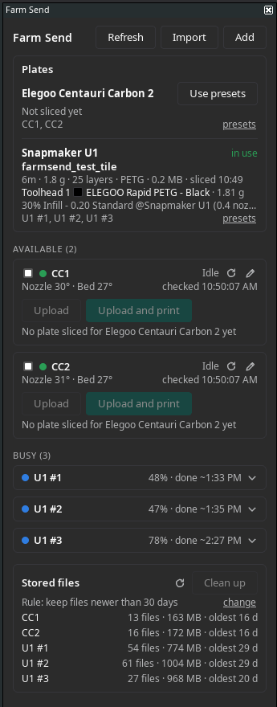
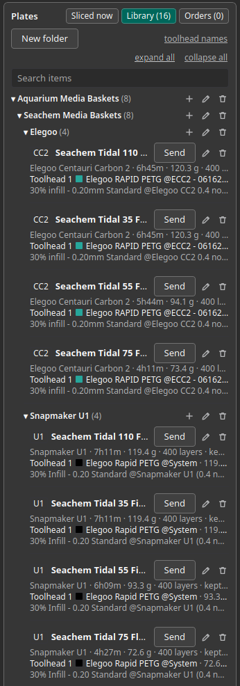
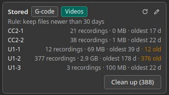

# Farm Send for OrcaSlicer

A docked panel for small print farms: slice a plate once per printer type, then upload it and start it on several printers at once, with live status for every printer.



- **Elegoo Centauri Carbon 2**: upload and start the print. Stock OrcaSlicer can upload to a Centauri Carbon 2 but cannot start it.
- **Snapmaker U1**: upload and start the print, with bed leveling, flow calibration and time-lapse options.
- **Other Moonraker / Klipper printers**: upload and a plain start. Not tested beyond the U1.

Each printer card shows its state, and while printing its progress, time left and expected finish time. **Details** on a card adds temperatures, when it was last checked, and what is loaded: the rolls of a Centauri Carbon 2's Canvas unit or the four toolheads of a U1, as small tags with color and material. Status updates on its own every few seconds; **Refresh** in the header asks every printer now, and the refresh icon on a card asks that one. The version is shown next to the panel title.

While the panel is open, OrcaSlicer shows a notification when a print finishes, is cancelled, pauses, or a printer stops with an error. The same note stays on the printer card until the printer moves on. Nothing is reported while OrcaSlicer is closed, and the notification appears inside OrcaSlicer, not as a system notification.

## Status: early release

Farm Send uses OrcaSlicer's Python plugin system (OrcaSlicer 2.5.1 or newer), which OrcaSlicer itself calls experimental.

| | |
|---|---|
| Developed and tested on | Linux, OrcaSlicer 2.5.1 |
| Windows, macOS | **Not tested.** Reports welcome |
| Centauri Carbon 2 | Tested on two printers, single-filament jobs. Slicer filament slot N prints from roll N of the Canvas unit (verified with slot 1 on two printers). Multi-color jobs are not tested |
| Snapmaker U1 | Tested on three printers, firmware 2.1.2. Slicer filament slot N prints on toolhead N |

The printer protocols were worked out from the vendors' own clients, not from published specifications. A firmware update can break them.

**It starts real prints on real machines.** Look at the bed before you confirm.

## Use

The panel reads top to bottom in the order you work:

1. **Plates** has one row per printer type. Each row shows the plate held for that type (time, grams, layers, toolhead and color), or "Not sliced yet". Slice once for each type you want to print on.
2. The printer list is grouped: **Needs attention** (paused, error, offline, or a finished print still on the bed), **Available** (idle with a clear bed) and **Busy** (one line each; click a line for details). Each group folds with the arrow in front of its name, and each card folds with the arrow in its corner.
3. On a printer card click **Upload**, or **Upload and print**, and confirm. The printer gets the plate sliced for its type.

To send everything at once, click **select all available**, then **Upload and print on all**.
The U1s get the U1 plate and the CC2s get the CC2 plate, in one action.

The plugin keeps its own copy of each slice, because OrcaSlicer overwrites its temp G-code on the next slice.
A slice for a printer model that has no printer in Farm Send is ignored: nothing is shown and nothing is kept. Add the printer first, then slice.
Slicing again for a type replaces that type's plate only.
You can re-arrange the bed between types: the "plate changed" warning only ever applies to the most recent slice. Copies are deleted when the project closes.

**Presets per printer type**

Select the printer, process and filament presets you use for one printer type, click **presets** on that type's row, then **Remember current**.
**Use presets** on the row then switches all three OrcaSlicer selections back in one click. Then slice.
If a preset has unsaved edits, OrcaSlicer shows its normal save or discard dialog first.
The plugin cannot press Slice for you.

**Library**



For parts you print again and again. On a sliced plate's row click **Save**, name the item and enter how many parts are on the plate (the count is filled in when the G-code labels its parts). A plate already in the library shows **saved**.
The plate is kept on this computer, in the plugin's own data folder, and survives closing the project and restarting OrcaSlicer.
You can also put it in a folder. The save dialog can make a new folder on the spot, inside the folder you picked. Folders start collapsed. **New folder** in the Library view makes one at the top, and the plus on a folder makes one inside it, up to four levels. The pencil and bin on a folder rename or remove it; removing a folder keeps what is in it and moves it up one level. The pencil on a library row renames the item, corrects the count or moves it to another folder.
In the Plates box, **Library** lists what you kept, grouped by folder, with search. **Send** shows the printers of the right type with their state, and the total parts for the printers you tick, then uploads and starts them. No project, no slicing.

A kept plate is the G-code exactly as sliced: printer type, nozzle, material and temperatures do not change. To change any of those, slice again and save a new plate.
On Snapmaker U1s a one-filament plate can be printed from any toolhead, so one kept plate covers every color: choose the toolhead in the send dialog, which lists what each printer's toolheads hold.
The same toolhead number is used on every printer you tick, so this assumes your printers keep the same color in the same position.
A start is refused when that toolhead reports no filament or holds a different material. Printing as sliced is also refused when the toolhead reports a clearly different color than the plate was sliced with, until you confirm the loaded color in the dialog. When you pick another toolhead, the dialog shows what each printer holds there and warns if they differ.
Two complete prints through a remapped toolhead have run on real U1s (a pool drain plate sent to toolhead 4 on U1-2 and U1-3, both finished).

**Printing part of a plate (Snapmaker U1)**

In the library send dialog, **Parts to print per printer** defaults to the full plate. Enter less and the printer is told to skip the other parts as it starts; the panel reports the start only after the printer confirms, and cancels the print if it does not. So one full plate in the library covers any quantity.
This works when the plate's parts are labelled one by one in the G-code and that number equals the parts count you entered. The kept parts are the first ones in the plate's own order. The time and grams shown are still those of the full plate.
On a Centauri Carbon 2 with a Canvas unit, the start tells the printer which roll each filament number prints from: filament 1 from roll 1, and so on. Left unsaid, the printer reuses the rolls of its previous print. The card lists the rolls as the printer reports them; their colors are the ones entered on the printer and are not compared with the sliced color. For a one-filament plate, **Print from roll** in the send dialog picks another roll; the start is refused when the printer reports a different material there.

A Centauri Carbon 2 prints whole plates only, so keep a small plate for it if you want small quantities there.

**Orders**

For "I need 10 of these". In the Plates box open **Orders**, click **New order**, pick a library item and enter the quantity. Optionally pick the toolhead for Snapmaker printers and add a note.
**Print next** splits what is left evenly over the printers that are free right now: idle, bed cleared, and no uncounted plate on them. Ten parts over five printers that can skip parts is two each. A printer that prints whole plates only gets the kept plate nearest its share, and is left out when that plate would be more than double the share. Edit any count, untick what you do not want, then **Start prints**.
When a plate finishes, **Bed cleared** on that printer asks how many parts came out good. Only good parts count. The order line shows good, printing and still to start, and is remembered across restarts.

**Several plates in one project**

After **Slice all**, every plate is held for its printer type, one line each; click a line for its details. **Save all to library** names and keeps every plate not saved yet in one dialog, each with its own name, parts count and folder. The dot in front of a plate marks the one the printer cards send; click another plate's dot to change it. The printer type OrcaSlicer is set to stays open and the others fold to one line; **clear** drops the sliced plates of a type. Slicing a plate again replaces that plate only.

**Toolhead names**

**toolhead names** in the Library view lets you label the four toolhead positions (Black, White and so on) if you keep them the same on every printer. These are labels only; the color check compares what the printer reports with what the plate was sliced with.

**Stored files and cleanup**



The **Stored** box at the bottom lists every printer with its file count, size and oldest file, and how many files count as old under your rule.
The pencil next to refresh sets the rule: keep files newer than N days, or keep the newest N files. **Clean up** shows what will be removed per printer and asks before deleting.
The file a printer is printing is always kept. A Centauri Carbon 2 is only cleaned while idle. Deleted files cannot be brought back.

The **Videos** tab of the same box does this for time-lapse recordings, with its own rule. Recordings are removed only when you click Clean up, never automatically.

- **Snapmaker U1**: each recording is removed together with its pictures, through Snapmaker's camera service (the camera folder is read-only to the file API). The recording of a print that is running and the camera's live picture are kept.
- **Centauri Carbon 2**: a recording is the frames of one finished print (one per layer), plus its video if one was exported. Farm Send reads the print's layer count from its G-code file and removes just those frames, usually in one request; when the G-code is already gone from the printer it removes the first 3000 frames. Layer counts are saved in the plugin's storage folder, so they are not lost when OrcaSlicer restarts. Removing a recording also removes that print from the printer's history list. It works only while the printer is idle and relies on a path the printer does not officially offer (verified on two printers on 2026-11-21), so a firmware update may stop it. Frame deletions cannot be checked one by one: the printer answers "ok" either way.

"Clean automatically, once a day" is off by default and only runs while the panel is open, so it does not replace a scheduled job for an unattended farm.
A Centauri Carbon 2 holding 250 or more files shows a warning on its card: uploads began failing on printers holding 355 and 516 files.

**Guards**

- G-code sliced for one printer model cannot be sent to another model. Checked in the plugin, not only in the page.
- "Upload and print" only starts when the printer reports idle. If it is busy the file is still uploaded and you are told it was not started.
- Every start asks for confirmation and names the printers.
- Uploaded files are named `<object>_<filament>_<time>_<YYYYMMDD-HHMMSS>.gcode`, so nothing is overwritten.
- A printer with no plate sliced for its type cannot be sent to.
- A plate sliced for a different nozzle size than the printer preset records is refused. Click **Import** once so the plugin knows each printer's nozzle size; a printer with no size on record is not checked.
- After a print ends, the printer is held under Needs attention and cannot be started again until you click **Bed cleared** on its card. Uploading without printing is still allowed. This is remembered across restarts and shared between OrcaSlicer windows. It only knows about prints the panel saw, or a printer that reports a completed print when first seen, so still look at the bed.

## Install

1. OrcaSlicer > menu > **Plugins** > **Install local plugin** > `dist/farm_send/farm_send.py`
2. Tick **Activate**. OrcaSlicer asks once for: read access to its own temp G-code folder, permission to start threads, and network access to each saved printer address. Answering No stops the plugin from loading.
3. Expand the row and click the run arrow. The panel docks to the right of the 3D view.
4. **Import** pulls printers from the printer presets OrcaSlicer has loaded (address and access code). **Add** adds one by hand; **Test connection** fills in the model.

To load a newer build into a running OrcaSlicer: Plugins > **Refresh**, untick and tick Farm Send, then run it. When a newer version has been installed than the one the window is running, an orange "↻ 0.3.x" label replaces the version next to the panel title; hover over it for these steps.

From then on the panel opens by itself when OrcaSlicer starts. It opens once per session, so closing it keeps it closed. Untick **Open this panel when OrcaSlicer starts** at the bottom of the panel to open it only from the Plugins dialog.
After adding a printer, OrcaSlicer asks for network access to it the next time the plugin loads.

If you install both the Plugin Hub copy and a local file copy, only one can be active at a time; OrcaSlicer reports a "capability collision" for the second. Each copy keeps its own printer list.

## Permissions and privacy

- **Network**: only the printer addresses you save. The plugin contacts nothing else: no cloud, no telemetry, no update check.
- **Files**: read access to OrcaSlicer's temp G-code folder, to copy each slice. Everything it writes stays in its own storage folder.
- **Presets**: the panel reads which printer, process and filament presets are selected, and **Import** reads your own printer presets (name, model, nozzle size, address and API key) to offer them as printers. OrcaSlicer has no permission prompt for reading presets, so nothing asks you; nothing read this way leaves your computer except to reach the printer itself.
- **Access codes are stored as plain text** in `<OrcaSlicer config>/orca_plugins/plugin_data/farm_send/farm_send_printers.json`. The file is created readable only by your user account. Anyone with access to your account can read it, as with the printer presets OrcaSlicer itself stores.
- Printers are reached over plain HTTP, MQTT and websocket on your local network, as the vendors' own slicers do. Use it on a network you trust.

## Print history

**Print history** at the bottom of the panel lists every print started from the panel: the item, the printer, when, how many parts, how long it took and how it ended (finished, cancelled, error, or stopped early), plus the good-parts count if you entered one at **Bed cleared**. A line per printer counts started, finished and not finished. **Copy as CSV** puts the list on the clipboard for a spreadsheet. It is kept in `farm_send_runs.json` in the plugin's storage folder, newest 2000 prints. Prints started at the printer are not recorded, and an ending is only noticed while the panel is open.

## Reporting a problem or requesting an enhancement

Open an issue at https://github.com/mlugo-apx/orca-farm-send/issues and pick the form that fits. For an enhancement, describe what you want to do and how you do it today. For a problem, click **Report a problem or request an enhancement** at the bottom of the panel first: it collects the plugin version, your system, and each printer's model and state, ready to paste. Printer names, addresses and access codes are left out; messages can include file names, so read it before posting. Add your OrcaSlicer version, the printer's firmware version, what you clicked, and the exact message shown.

## Develop

```
python3 tests/test_farm.py            # tests against in-process fake printers
python3 tests/hardware_check.py       # read-only check of your real printers
python3 tests/hardware_check.py --upload "U1 #2"   # 1 KB upload, list, delete. Never prints.
./install.sh                          # rebuild and copy over the installed plugin
```

`src/core.py` holds the printer protocols, `src/app.py` the logic, `src/panel.html` the UI, `src/shell.py` the OrcaSlicer glue.
`build.py` bundles them into the single file OrcaSlicer requires.

## How it works

- **Capture**: OrcaSlicer fires a `GCodeExportFinished` lifecycle event after each slice with the path of the plate's temp G-code. No preset or post-processing change is needed. Post-processing scripts are therefore not applied; the panel warns when the preset has any.
- **CC2**: chunked HTTP `PUT /upload` with an MD5 header, then MQTT on port 1883 (register, status `1002`, start `1020`). One client id per printer is reused, because the printer has only a few client slots and holds each for about a minute. Every OrcaSlicer window of one user shares that id and takes turns through a lock file in the plugin storage folder, so several windows together use one slot.
- **Snapmaker U1**: `/server/files/upload` with `print=false`, then `server.files.start_local_print` over the websocket with `bed_level`, `flow_calibrate` and `time_lapse_camera` options. That method does not exist over HTTP. A plain Moonraker start carries no options, and the U1 then skips auto bed leveling. Stock OrcaSlicer's U1 start G-code tries `SET_PRINT_AUTO_BED_LEVELING`, which firmware 2.1.2 rejects as unknown.
- **Other Moonraker printers**: fall back to `/printer/print/start`.
- The plate box and the confirmation show the toolhead, color and grams the G-code uses, and what the printer reports as loaded in that toolhead.

## What has been verified, and how

Tested 2026-11-18 to 21 on OrcaSlicer 2.5.1 (Linux) with two Centauri Carbon 2s (called "CC1" and "CC2" in the older rows, "CC2-1" and "CC2-2" now) and three Snapmaker U1s.

The first in-app checks ran in an OrcaSlicer instance on a hidden virtual display (Xvfb), started through the desktop launcher. Since 2026-11-20 they run in a visible OrcaSlicer window.

| What | How it was verified |
|---|---|
| Status, all 5 printers | Real printers |
| Upload, list, delete on U1 #1, #2, #3 | Real printers, during a print, print unaffected |
| Upload-and-print refused on a busy U1 | Real printer: file uploaded, not started |
| Cross-model block | Real sliced G-code, refused before any network call |
| One CC2 slot shared by all windows | Real CC1 and CC2: 8 processes at once, 96 requests, no errors, one client id per printer |
| Refresh one printer and Refresh all, finish time, last-checked time | Clicked inside OrcaSlicer 2.5.1 against all five real printers |
| Notices for finished, cancelled, stopped | Real printers with the panel open: the print history holds 3 finished, 1 cancelled and 5 stopped endings read from real U1s and CC2s; a CC2 stopped at 42% showed "stopped printing ... at 42%" on its card (2026-11-21). Paused and error notices: fake printers only |
| Plates per printer type, grouped printer list, expandable busy rows, presets dialog, Bed cleared | Clicked inside OrcaSlicer 2.5.1 against all five real printers |
| Stored-file counts, cleanup rule and confirmation dialog | Real printers: counts and rule previews on all five; dialogs opened inside OrcaSlicer 2.5.1 and cancelled |
| Cleanup deleting files | Fake printers (250-file CC2, kept-file case). Real CC2: paging and batch delete proven with probe files only. No real user file has been deleted |
| Time left on a U1 | Real U1s: 4h55m shown 44 minutes into a 5h14m job (was 11 to 12 hours) |
| CC2 slot leak fixed | Real CC2: 40 polls in 65 s, second client still connects |
| Install, activate, panel, Import, live cards | Inside OrcaSlicer 2.5.1 |
| Slice capture event | Inside OrcaSlicer 2.5.1: event received with the temp path |
| CC2 upload, list, delete | Real CC1 and CC2 (2026-11-19) |
| Upload and start on U1 #1 and #2, single and batch | Real printers, 2026-11-19, 24-clip plate in white on toolhead 2 |
| U1 start with bed leveling option | Real printers: leveling flag on, and the printer's "does not do auto-leveling" message no longer appears |
| Start print on CC2, with bed leveling | Real CC1 and CC2 from the panel inside OrcaSlicer: 25-layer test tile completed on both (2026-11-19) |
| Slice capture, copy and plate display | Inside OrcaSlicer 2.5.1 |
| Slice for U1, switch presets, slice for CC2, both plates kept | Inside OrcaSlicer 2.5.1 |
| "Use presets" switching printer, filament slots and process, both directions | Inside OrcaSlicer 2.5.1 |
| Select all available, grouped confirmation | Inside OrcaSlicer 2.5.1, cancelled before sending |
| CC2 prints from the roll the slicer names | Real CC2-1 and CC2-2: started with filament 1 sent to roll 1, both switched from roll 2 to roll 1 before the first layer (2026-11-20) |
| U1 time-lapse clean-up | Real U1-1 (2026-11-21): one recording removed through Snapmaker's camera service, its video, picture and cover gone. The 0.3.9 to 0.3.12 file-by-file removal failed on every U1 with HTTP 405 |
| CC2 time-lapse clean-up | Real CC2-1: 24 recordings down to 21, G-code untouched (2026-11-21) |
| CC2 frames end at the layer count | Real CC2-1: frames 0 to 41 of a 37-layer print removed in one request; asking the printer to export it afterwards made no video (2026-11-21) |
| Part count (printer skips the other parts) | Real U1-2: Left_Vertical_Clip plate of 28, 2 kept, 26 skipped, finished |
| Library send, "Print from roll" on a CC2 | Real CC2-1 (2026-11-21): a 10 mm cube sliced for roll 1 printed from roll 2; the printer switched to roll 2 before layer 1 and the card said "from roll 2" |
| CC2 layer counts kept for clean-up | Real: the storage folder holds counts for 20 and 26 recordings on the two CC2s |
| Slice for a printer outside the farm is ignored | Inside OrcaSlicer 2.5.1 (0.3.15): a cube sliced for an Anycubic Kobra 2 Max left no plate row, no "Slicing..." and no kept copy |

### Checked only against the test printers

These pass the automated tests, which use stand-in printers, but have not been seen working on a real printer or in real use:

- **Orders**: Print next splitting a quantity over free printers, and good-part counts from Bed cleared. No real order has been run.
- **Automatic daily G-code clean-up**, and G-code clean-up deleting real files (only probe files have been deleted on a real CC2; U1 file delete is proven).
- **Paused and error notices.**
- **Clean-up guards**: a busy CC2 refusing video clean-up, and a U1 keeping the recording of the print that is running.
- **The "newer version installed" line** (0.3.14): unit-tested; not yet seen in a window.
- **Multi-color CC2 jobs** (several rolls in one print) and **Windows / macOS**.

The U1 time-lapse clean-up shipped in 0.3.9 to 0.3.12 passed its tests and failed on every real U1, because the stand-in printer allowed what the real one refuses. The stand-in now refuses it too, but treat this list as untested until it moves into the table above.
